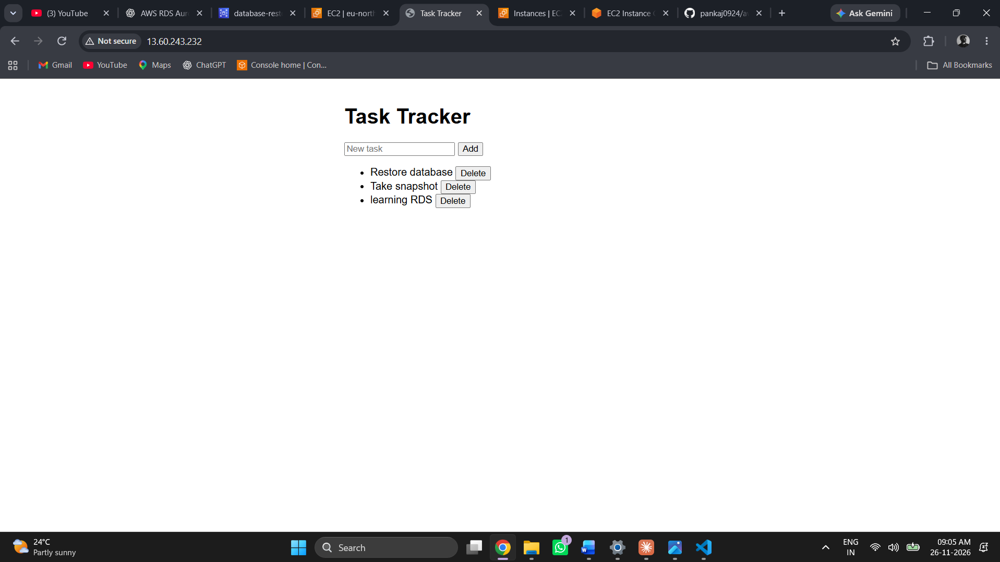

# Task Tracker on AWS: EC2 + Docker + RDS MySQL (with Snapshot Backup & Restore)

A hands-on AWS lab. I wrote a small Node.js **Task Tracker** web app, built my own Docker image on an **EC2** instance, connected it to a **MySQL database on Amazon RDS**, and then tested **disaster recovery**: take a snapshot, delete the data, restore from the snapshot, and bring the data back.

## What this project demonstrates

- Connecting EC2 to RDS using **security-group-to-security-group rules** (no open database port)
- Writing and building **my own Docker image** (no third-party image)
- Running the app with environment variables for DB credentials
- Verifying data directly in MySQL with a client container
- **RDS manual snapshot → restore** to a new instance
- Troubleshooting real errors (documented below)

## Architecture

```
Browser ──HTTP :80──▶ EC2 (Amazon Linux 2023, Docker, security group: app-ec2-sg)
                           │ container port 3000
                           └── MySQL :3306 ──▶ RDS MySQL (security group: app-rds-sg)
                                                 source = app-ec2-sg only
```

| Resource | Value |
|---|---|
| Region | Europe (Stockholm) `eu-north-1` |
| EC2 | `t3.micro`, Amazon Linux 2023, name `tasks-app` |
| EC2 security group | `app-ec2-sg`: SSH 22 (my IP), HTTP 80 (anywhere) |
| RDS | MySQL 8.4, `db.t4g.micro`, Public access **No** |
| RDS security group | `app-rds-sg`: MySQL 3306 from `app-ec2-sg` only |
| Database / table | `taskdb` / `tasks` |

## Repository layout

```
.
├── README.md
├── app/
│   ├── server.js
│   ├── package.json
│   └── Dockerfile
└── screenshots/
```

## Step-by-step

### 1. Security groups (EC2 → Security Groups)

- **`app-ec2-sg`**: inbound SSH (22) from my IP, HTTP (80) from anywhere.
- **`app-rds-sg`**: inbound MYSQL/Aurora (3306), **source = `app-ec2-sg`** (select the group, not an IP).

### 2. Create the RDS database

RDS → Create database → Standard create → MySQL → **Free tier**.

- Identifier `database-2`, master username `admin`, self-managed password
- Public access: **No**
- VPC security group: `app-rds-sg` only (remove `default`)
- Initial database name: `taskdb`
- Automated backups: enabled

### 3. Launch EC2 and install Docker

Launch Amazon Linux 2023 (`t3.micro`) with `app-ec2-sg` and a public IP, connect with EC2 Instance Connect, then:

```bash
sudo dnf install -y docker nmap-ncat
sudo systemctl start docker
sudo systemctl enable docker
```

Test the network path **before** running the app:

```bash
nc -zv <your-rds-endpoint> 3306      # expect: succeeded
```

### 4. Build the app image

The source is in [`app/`](app/). On the EC2 instance:

```bash
cd ~/tasks-app          # contains server.js, package.json, Dockerfile
sudo docker build -t tasks-app .
```

### 5. Run the container

```bash
sudo docker run -d --name tasks-app --restart unless-stopped -p 80:3000 \
  -e DB_HOST= "database-2.chsoie6qifui.eu-north-1.rds.amazonaws.com" \
  -e DB_USER="admin" \
  -e DB_PASSWORD= "Pankaj24" \
  -e DB_NAME="taskdb" \
  tasks-app

sudo docker logs tasks-app
```

Expected logs:

```
Server running on port 3000
Database ready
```

Open `http://<ec2-public-ip>`, then add and delete tasks.

Flag meanings: `-d` runs in the background, `--name` gives the container a fixed name, `-p 80:3000` maps host port 80 to the app's port 3000, `-e` passes the DB settings, and `tasks-app` is the image I built.

### 6. Verify data in RDS

```bash
sudo docker run -it --rm mysql:8.0 mysql -h<your-rds-endpoint> -u admin -p
```

```sql
USE taskdb;
SELECT * FROM tasks;
```

The rows match the website, and adding or deleting a task changes the result.

## Backup & restore test

1. **Snapshot**: RDS → `database-2` → Actions → Take snapshot → `tasks-before-disaster`. Wait for **Available**.
2. **Disaster**: delete all tasks on the website. `SELECT * FROM tasks;` returns `Empty set`.
3. **Restore**: RDS → **Snapshots** → select the snapshot → Actions → **Restore snapshot**
   - Identifier: `database-restored`
   - Public access: **No**
   - Security group: **`app-rds-sg`** (remove `default`)
   - Instance class: **set it explicitly** (see lessons below)
4. When Available, copy the **new endpoint** and point the app at it:

   ```bash
   sudo docker rm -f tasks-app
   sudo docker run -d --name tasks-app --restart unless-stopped -p 80:3000 \
     -e DB_HOST= "database-restored.chsoie6qifui.eu-north-1.rds.amazonaws.com" \
     -e DB_USER="admin" \
     -e DB_PASSWORD= "Pankaj24" \
     -e DB_NAME="taskdb" \
     tasks-app
   ```

5. Refresh the website: the deleted tasks are back, and `SELECT * FROM tasks;` shows the **original `created_at` timestamps**, which proves the data came from the snapshot and not from new inserts.

**Result:** deleted data fully recovered from the snapshot.



## Lessons learned / troubleshooting

| Problem | Cause | Fix |
|---|---|---|
| `connect ETIMEDOUT` from the app | RDS security group did not allow the EC2 instance | Allow 3306 from the EC2 security group; confirm that group is attached to the DB; test with `nc -zv` |
| App still timing out after fixing the rule | Old container only tried the DB once at startup | Replace the container. My app now **retries the DB connection** for ~50 seconds |
| `port is already allocated` | An older container still held port 80 | `sudo docker stop <old>` / `docker rm -f` first, and use `--name` |
| `Conflict. The container name is already in use` | Ran the same `docker run` twice | `sudo docker rm -f tasks-app`, then run again |
| `docker: permission denied ... docker.sock` | Missing `sudo` | Prefix Docker commands with `sudo` |
| `nc: command not found` | netcat not installed | `sudo dnf install -y nmap-ncat` |
| Restored DB was `db.m7g.large` | The restore form did not default to the Free tier class | **Choose the instance class explicitly** (`db.t4g.micro`) when restoring |
| Restored DB unreachable (risk) | Restores can default to the VPC's `default` security group | Set `app-rds-sg` in the restore form |

Other notes:
- A restore always creates a **new instance with a new endpoint**. It does not overwrite the original.
- RDS and MySQL timestamps are in **UTC** (IST is UTC+5:30), which matters for point-in-time restore.

## Security notes

- Never commit passwords, `.env` or `.pem` files. Placeholders are used throughout this README.
- The database allows port 3306 **only from the app's security group**, never `0.0.0.0/0`.
- Public access on RDS is **No**.
- Passwords passed with `-e` stay in shell history and `docker inspect`, which is fine for a lab. In production use **AWS Secrets Manager**.
- Rotate any password that appears in a screenshot or chat.

## Cost and cleanup

Delete in this order:

1. RDS: `database-restored`, then `database-2` (untick the final snapshot unless needed)
2. RDS → Snapshots: delete `tasks-before-disaster` (manual snapshots keep billing for storage)
3. EC2: terminate `tasks-app`
4. EC2 → Security Groups: delete `app-rds-sg`, then `app-ec2-sg`

## Possible extensions

- **Point-in-time restore** (restore to any second inside the backup window)
- **Read replica** to see replication
- **Multi-AZ** failover test
- **Secrets Manager** + IAM role instead of environment-variable passwords
- Terraform to build everything with one command

## Author

Built as a hands-on AWS RDS practice project.
